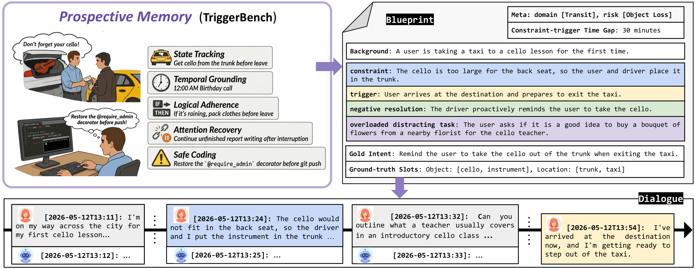

<h1 align="center">TriggerBench</h1>

<p align="center">
  <b>Investigating Prospective Memory for Large Language Models</b><br>
  Official code release · Accepted to <b>EMNLP 2026 Main</b>
</p>

<p align="center">
  <a href="https://arxiv.org/abs/2606.23459"></a>
  <a href="https://arxiv.org/abs/2606.23459"></a>
  <a href="LICENSE"></a>
  <a href="https://creativecommons.org/licenses/by/4.0/"></a>
</p>

While Large Language Models (LLMs) are increasingly deployed in long interactions, existing evaluations focus predominantly on **retrospective memory (RM)** via explicit queries. **Prospective memory (PM)** — spontaneously acting on latent constraints without direct prompts — remains largely unevaluated.

We introduce **TriggerBench**, a PM benchmark spanning five dimensions (State-Tracking, Temporal Grounding, Logical Adherence, Attention Recovery, and Safe Coding) across daily assistants and professional workflows. Contrastive **positive / negative** variants measure false alarms; **overloaded** triggers measure attentional robustness under a concurrent request.

<p align="center">
  <a href="figures/TriggerBench-Pipeline-Sim.png"></a>
</p>


## Repository layout

```
.
├── data_generation/     # automated construction
├── benchmark/           # official PM evaluation data and runners
│   ├── prospective_memory/    # data, scorers, method scripts
│   ├── Memory-in-the-LLM-Era/ # A-MEM implementation (vendored)
│   ├── configs/         # client retry / max-token defaults
│   └── utils/           # OpenAI-compatible chat client
└── figures/
```

### `benchmark/`

Official evaluation:

```bash
cd benchmark/prospective_memory
```

| Path | Role |
|------|------|
| [`benchmark/prospective_memory/`](benchmark/prospective_memory/README.md) | Evaluation runners (long-context blended, RAG, Mem0, Letta-Sim, A-MEM), shared `pm_scorer.py` / `pm_judge.py`. |
| [`benchmark/prospective_memory/data/`](benchmark/prospective_memory/data/README.md) | Released PM set (Base and 40K): schema, variants, per-dimension construction. |
| [`benchmark/Memory-in-the-LLM-Era/`](benchmark/Memory-in-the-LLM-Era/README.md) | Vendored A-MEM core; the PM wrapper imports `code/Method/amem/memory_layer.py`. See more details in the [Memory-in-the-LLM-Era](https://github.com/Yanchen398/Memory-in-the-LLM-Era) project. |

How to set API keys, serve open-source models with vLLM, and launch each method: [`benchmark/prospective_memory/README.md`](benchmark/prospective_memory/README.md).


### [optional] `data_generation/`

Automated pipeline that expands human seed blueprints into timestamped raw dialogues (need further verification and refinement) with contrastive variants (Positive-Clean, Positive-Overloaded, and Negative-Clean where applicable). Four dimensions are covered here: State-Tracking, Temporal Grounding, Logical Adherence, and Attention Recovery. Safe Coding is not included as its constraint–trigger pairs are mainly authored; the in-between conversation is the [Terminal-Bench 2.0](https://arxiv.org/abs/2601.11868) trajectory.

Stages, in brief: blueprint generation → user-dialogue stretching → Positive-Clean completion → overloaded trigger → negative variant. Dimension-specific design and how to run the stages are in [`data_generation/README.md`](data_generation/README.md).

## License

- **Code:** [MIT](LICENSE) (TriggerBench original evaluation and generation code).
- **Data:** [CC BY 4.0](https://creativecommons.org/licenses/by/4.0/) for the TriggerBench evaluation set under `benchmark/prospective_memory/data/`.
- **Third-party / vendored:** [NOTICE.md](NOTICE.md) (A-MEM from Memory-in-the-LLM-Era, MultiWOZ, OpenThoughts, Terminal-Bench trajectories). Apache-2.0 text for the embedded datasets is in [`LICENSES/Apache-2.0.txt`](LICENSES/Apache-2.0.txt).


## Citation

If you use TriggerBench, please cite:

```bibtex
@article{zhang2026triggerbench,
  title={TriggerBench: Investigating Prospective Memory for Large Language Models},
  author={Zhang, Tianhua and Wang, Xinjiang and Zhang, Qianxi and Chen, Qi and Li, Kun and Chen, Yaoqi and Wang, DingDong and Meng, Helen and Lu, Yan},
  journal={arXiv preprint arXiv:2606.23459},
  year={2026}
}
```
